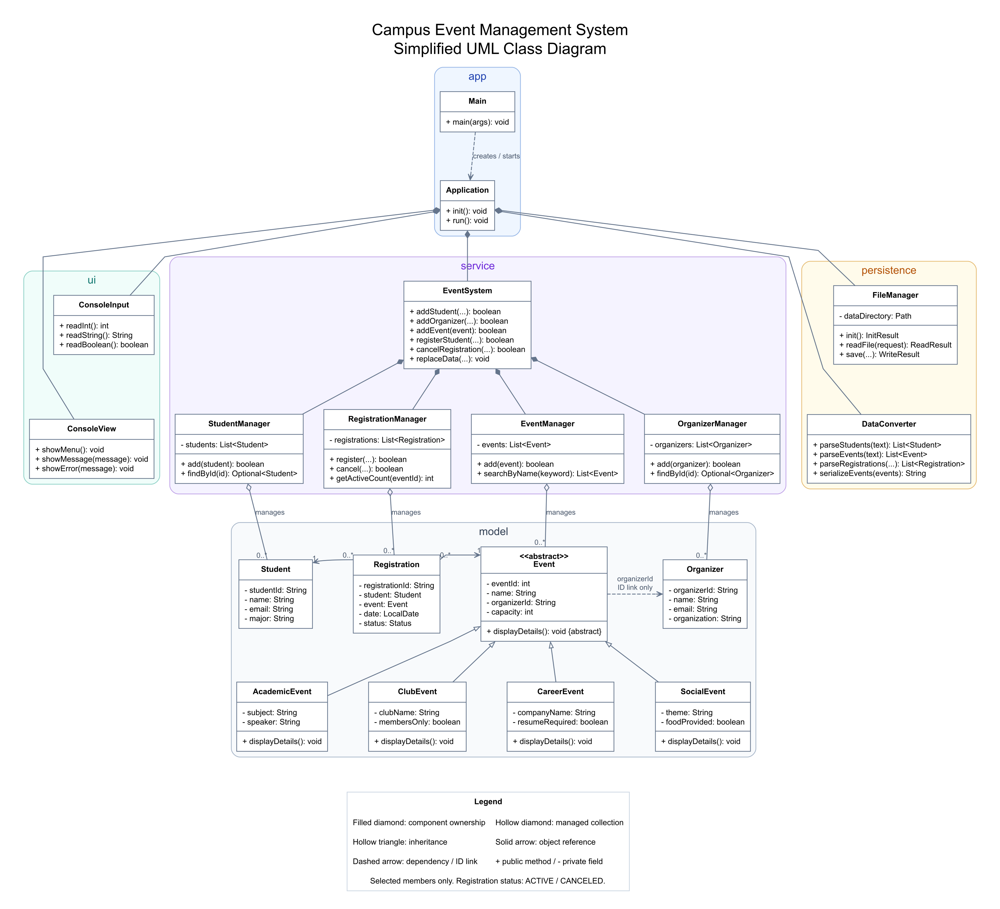

# Campus Event Management System

A menu-driven Java console application for managing campus events, students,
organizers, and event registrations. The project demonstrates object-oriented
design, Java collections, and text-file persistence.

## Features

- Add students, list all students, and find a student by ID.
- Add organizers, find organizers by ID, and view the events they manage.
- Create, list, and search events by name, or find an event by ID.
- Support academic, club, career, and social events with type-specific details.
- Register students for events and cancel registrations.
- Reject duplicate IDs, duplicate active registrations, missing students or
  events, and registrations that exceed event capacity.
- View a student's registered events and an event's attendees.
- Load saved data at startup and save current data when selecting `0. Exit`.


## Requirements

- JDK 17 or newer, with `java` and `javac` available on your `PATH`.
- No external Java libraries or build tools are required.

## Build and Run

Open PowerShell in the project root, where `src` and `data` are located.

```powershell
New-Item -ItemType Directory -Path out -Force | Out-Null
$sources = Get-ChildItem -Path .\src -Recurse -Filter *.java |
    ForEach-Object { $_.FullName }
javac --release 17 -encoding UTF-8 -d out $sources
java -cp out app.Main
```

Run the application from the project root so it uses the included `data` folder.
Re-run the compilation command after changing source files.

## Using the Application

Enter a menu number and follow the prompts.

| Menu options | Operations |
| --- | --- |
| `1`, `2`, `15` | Add, list, or find students |
| `3`, `4`, `5`, `16` | Create, list, search, or find events |
| `6`, `7` | Register a student or cancel a registration |
| `8`, `9` | View student registrations or event attendees |
| `10`, `12`, `13`, `14` | List, add, or find organizers; view their events |
| `11` | Display system reports |
| `0` | Save data and exit |

Create an organizer before creating an event associated with that organizer.
Students and events must exist before a registration can be made. Student and
organizer IDs are strings; event IDs and capacities are integers. Use `true` or
`false` for the event-specific boolean prompts.

For a quick look at the included sample data, select `2` to view students, `4`
to view the four event types, and `11` to display reports. Select `0` to save
and exit normally.

## Project Structure

```text
CampusEventSystem-Java-/
|-- src/
|   |-- app/           Application startup, menu actions, and coordination
|   |-- model/         Student, Organizer, Registration, and event classes
|   |-- service/       Business operations and collection managers
|   |-- ui/            Console input and output helpers
|   `-- persistence/   File access, text conversion, and operation results
|-- data/              Saved text files and sample data
|-- docs/              Assignment specification and UML diagram
|-- tests/             Reserved for project tests
`-- README.md
```

## Main Classes and Design

- `Main` starts the application. `Application` coordinates initialization,
  console commands, data conversion, and saving.
- `EventSystem` coordinates student, organizer, event, and registration
  operations. Four manager classes store the corresponding collections in
  `ArrayList` instances through `List` interfaces.
- `Event` is an abstract base class. `AcademicEvent`, `ClubEvent`, `CareerEvent`,
  and `SocialEvent` override `displayDetails()`. Calling this method through an
  `Event` reference displays the appropriate event-specific details.
- `Registration` references the existing `Student` and `Event` objects and
  tracks the registration date and status. An event stores its organizer's ID.
- `FileManager` reads and writes text files. `DataConverter` converts between
  text and model objects. On loading, student and event IDs in registration
  records are resolved to the corresponding objects before publishing the data.
- `ConsoleInput` handles input, while `ConsoleView` provides display helpers.
  Some model and service methods also print their own details and results.

## Data Storage

Data is stored as UTF-8 text in four files relative to the current working
directory. Each file starts with a header row and uses `|` to separate fields.

| File | Contents |
| --- | --- |
| `data/students.txt` | Student ID, name, email, and major |
| `data/organizers.txt` | Organizer ID, name, email, and organization |
| `data/events.txt` | Event ID, type, shared event information, organizer ID, and type-specific fields |
| `data/registrations.txt` | Registration ID, student ID, event ID, registration date, and status |

Event type values are `ACADEMIC`, `CLUB`, `CAREER`, and `SOCIAL`. Registration
dates use `YYYY-MM-DD`. Saved registration statuses are `ACTIVE` and `CANCELLED`;
cancelled registrations remain stored but do not count toward event capacity.
Text fields cannot contain `|` or line breaks.

## UML



The editable diagram source is [docs/uml.dot](docs/uml.dot). It shows the major
classes, package groups, inheritance, component ownership, and model relationships.

