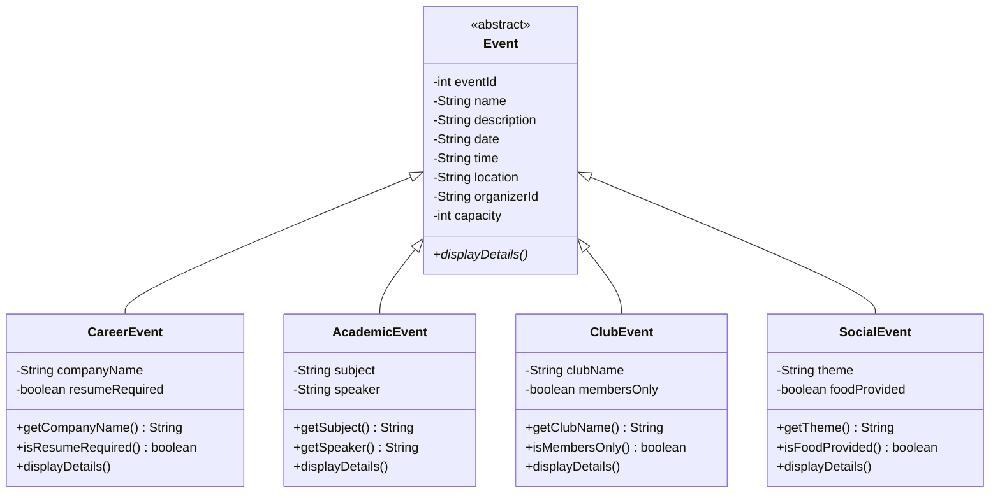

# Event Subclasses

Branch: `feature/subclasses` · Author: Ghazal Emami (`GhazalEmami`)

This branch adds the four event types for the Campus Event Management System. Each one is a subclass of the abstract `Event` class in `src/model`.

## Files

| File | Used for | Extra fields |
|---|---|---|
| `src/model/CareerEvent.java` | Job fairs, resume workshops | `companyName` (String), `resumeRequired` (boolean) |
| `src/model/AcademicEvent.java` | Guest lectures, study sessions | `subject` (String), `speaker` (String) |
| `src/model/ClubEvent.java` | Club meetings | `clubName` (String), `membersOnly` (boolean) |
| `src/model/SocialEvent.java` | Game nights, mixers | `theme` (String), `foodProvided` (boolean) |

## Class hierarchy



## Constructors

All four constructors take the 8 shared `Event` values first, in the same order as `Event`'s constructor, followed by the 2 values for that type:

```
(int eventId, String name, String description, String date, String time,
 String location, String organizerId, int capacity, <field 1>, <field 2>)
```

Each constructor:

1. Passes the 8 shared values to `Event` with `super(...)`.
2. Throws `IllegalArgumentException` if its main field (company name, subject, club name or theme) is `null` or blank.
3. Saves its own 2 fields.

## Example

```java
Event event = new CareerEvent(1, "Resume Workshop", "Get your resume reviewed",
        "October 15", "2:00 PM", "SSC 212", "ORG1", 30, "Google", true);

event.displayDetails();
```

Output:

```
Career Event: Resume Workshop
Description: Get your resume reviewed
Date: October 15 at 2:00 PM
Location: SSC 212
Organizer: ORG1
Capacity: 30
Company: Google
Resume Required: Yes
```

## OOP concepts used

- **Inheritance:** each class `extends Event` and reuses its fields and getters. A CareerEvent *is an* Event.
- **Abstraction:** `Event` is abstract, so only the four specific event types can be created.
- **Encapsulation:** all fields are `private`. Other classes read them through getters such as `getCompanyName()` and `isMembersOnly()`.
- **Method overriding:** each class overrides `displayDetails()` with `@Override` to print its own details.
- **Polymorphism:** `EventSystem` stores every event in one `ArrayList<Event>` and calls `event.displayDetails()` on each one. Java runs the right version for each event type.

## Error handling

The constructors throw `IllegalArgumentException` when the main field is blank, so an invalid event can never be created. Code that creates events from user input (the Create Event menu option) should catch this exception and show the message instead of crashing.

## Building

From the project root:

```bash
javac -d /tmp/campus-build $(find src -name "*.java")
```

No output means the build succeeded.

## Notes and limitations

- `speaker` is optional, because a study session might not have one, so it is not checked.
- There are no setters. The type-specific values are set once by the constructor, which validates them.
- The five shared print lines in `displayDetails()` are repeated in each class. A helper method in `Event` could remove that repetition.
- The menu does not create these event types yet, because `Application` is still a skeleton.
